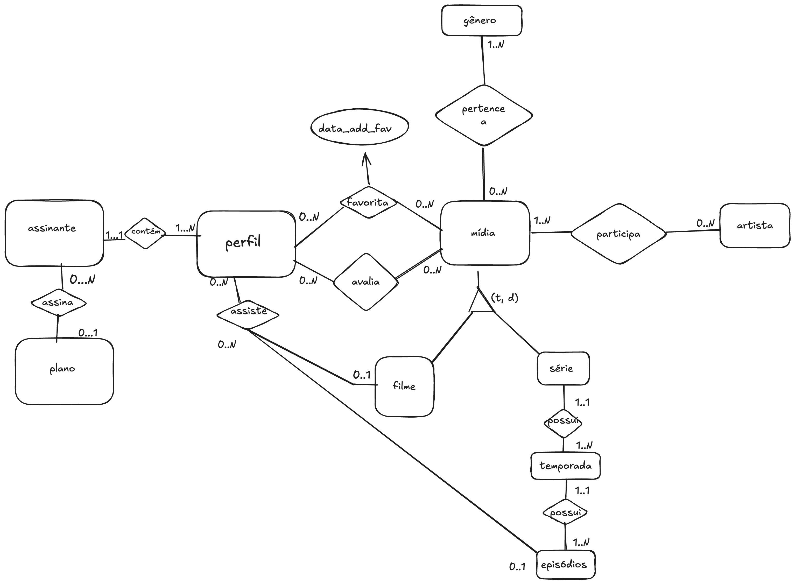
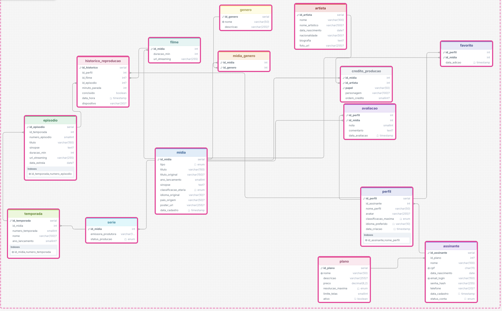

# Streaming DB Simulator

Trabalho prático em grupo da disciplina de Banco de Dados 2 da Universidade Federal de Goiás (UFG).

## Descrição geral do problema

Plataformas de streaming precisam gerenciar um grande volume de informações relacionadas aos seus usuários, planos de assinatura, perfis e conteúdos disponíveis no catálogo. Além do armazenamento dos filmes e séries, o sistema deve organizar esses conteúdos em gêneros, temporadas e episódios, bem como registrar os profissionais envolvidos em suas produções.

Também é necessário controlar as interações realizadas pelos usuários na plataforma, como a reprodução de conteúdos, a adição de títulos aos favoritos e a realização de avaliações.

Cada assinante pode possuir diferentes perfis, e cada perfil pode assistir, avaliar e favoritar títulos distintos.

## Produto a ser desenvolvido

Como solução para o problema apresentado, será desenvolvido um sistema de streaming de conteúdo audiovisual.

O sistema permitirá que um usuário assine um plano e possua diferentes perfis, cada um com suas próprias preferências e interações. O catálogo será composto por filmes e séries, organizados por gêneros. As séries serão divididas em temporadas e episódios. Também serão armazenadas informações sobre os artistas e demais profissionais participantes das produções.

Durante o uso da plataforma, o sistema permitirá que os perfis assistam aos conteúdos, adicionem títulos aos favoritos e realizem avaliações. Todas essas informações serão armazenadas em um banco de dados, garantindo a integridade e a organização dos dados para suportar as funcionalidades da aplicação.

## Escopo do sistema

- Gerenciamento de assinantes e planos de assinatura.
- Criação e gerenciamento de perfis.
- Cadastro e organização de filmes e séries.
- Classificação de títulos por gêneros.
- Organização de séries em temporadas e episódios.
- Registro de artistas e participação em produções.
- Controle das interações dos perfis na plataforma: reprodução, favoritos e avaliações.

O trabalho tem como foco a modelagem e o armazenamento das informações necessárias para essas funcionalidades. Neste momento, o escopo não contempla processamento financeiro de pagamentos, mecanismos avançados de recomendação ou funcionalidades de download.

## Módulos do sistema

### Assinatura e acesso

| Entidade | Descrição e informações armazenadas |
| --- | --- |
| `Assinante` | Dados pessoais, como CPF, e-mail de login e status da conta (ativa/inativa). |
| `Plano` | Preço, resolução máxima e limite de telas simultâneas. |
| `Perfil` | Nome do perfil, avatar e classificação indicativa máxima permitida (controle parental). |

### Conteúdo

| Entidade | Descrição e informações armazenadas |
| --- | --- |
| `Midia` | Superclasse que armazena título, ano de lançamento, sinopse e classificação etária. |
| `Filme` | Subconjunto de `Midia`: duração e URL/arquivo de streaming. |
| `Serie` | Subconjunto de `Midia`: emissora/produtora original. |
| `Temporada` | Pertence a uma `Serie` e armazena o número da temporada. |
| `Episodio` | Pertence a uma `Temporada`: número do episódio, título, duração e URL/arquivo. |
| `Genero` | Gêneros como Ação, Drama e Comédia, com relação N:N com `Midia`. |

### Pessoal e produção

| Entidade | Descrição e informações armazenadas |
| --- | --- |
| `Artista` | Nome, data de nascimento e nacionalidade. |
| `Credito_Producao` | Entidade associativa N:N entre `Midia` e `Artista`, armazenando papel e personagem. |

### Interação e métricas

| Entidade | Descrição e informações armazenadas |
| --- | --- |
| `Historico_Reproducao` | Entidade associativa entre `Perfil` e a mídia reproduzida, armazenando `minuto_parada`, `concluido` e `data_hora`. |
| `Avaliacao` | Associação entre `Perfil` e `Midia`, armazenando nota de 1 a 5 e `comentario`. |
| `Favorito` / `Minha_Lista` | Associação entre `Perfil` e `Midia`, armazenando a data em que a mídia foi salva. |

## Modelagem do banco de dados

### Modelo entidade-relacionamento



### Modelo relacional



## Execução com Docker

### Pré-requisito

- Docker Desktop ou Docker Engine com o Docker Compose.

### Inicializar o banco

Na raiz do projeto, execute:

```bash
docker compose up -d
```

Na primeira inicialização, o container executa automaticamente:

1. `streaming_schema_v2.sql`, que cria as tabelas e restrições;
2. `sql/02_dados.sql`, que popula o banco com dados de demonstração.

O serviço fica disponível em `localhost:5432` com as seguintes configurações:

| Configuração | Valor |
| --- | --- |
| Banco | `streaming_db` |
| Usuário | `streaming` |
| Senha | `streaming` |
| Porta | `5432` |

Para utilizar outra porta no computador, defina `POSTGRES_PORT`. Por exemplo:

```bash
POSTGRES_PORT=5433 docker compose up -d
```

### Executar as três consultas

```bash
docker compose exec -T postgres \
  psql -U streaming -d streaming_db -f /scripts/03_consultas.sql
```

Também é possível abrir o terminal interativo do PostgreSQL:

```bash
docker compose exec postgres psql -U streaming -d streaming_db
```

### Encerrar ou recriar o ambiente

Para encerrar os containers sem apagar os dados:

```bash
docker compose down
```

Para apagar o volume e recriar o banco desde o início:

```bash
docker compose down -v
docker compose up -d
```

> O comando com `-v` apaga os dados armazenados no banco do ambiente Docker.

## Arquivos da entrega

| Arquivo | Finalidade |
| --- | --- |
| `streaming_schema_v2.sql` | Criação do banco e das restrições de integridade. |
| `sql/02_dados.sql` | População reproduzível do banco. |
| `sql/03_consultas.sql` | Três consultas com junções de várias tabelas. |
| `compose.yaml` | Ambiente PostgreSQL padronizado para todos os integrantes. |
