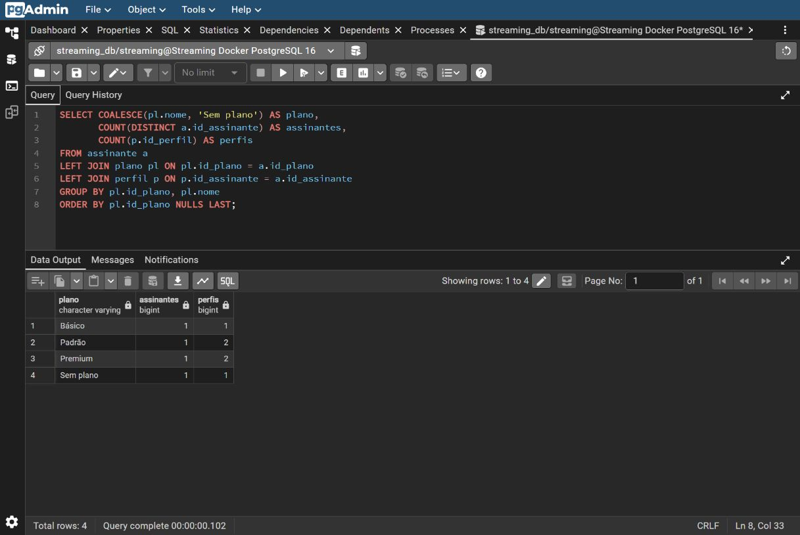
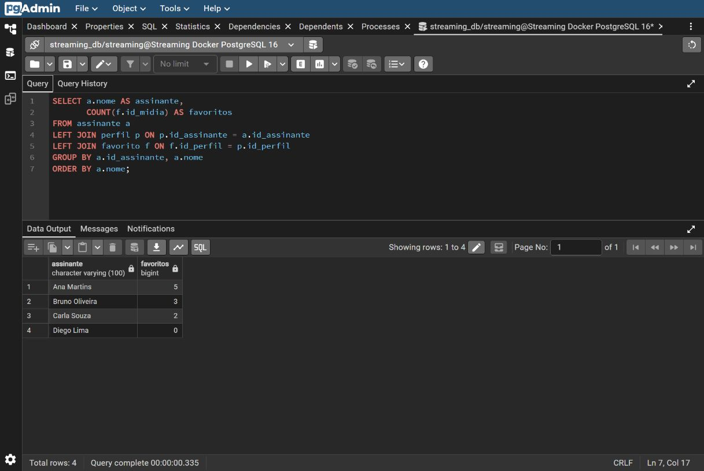
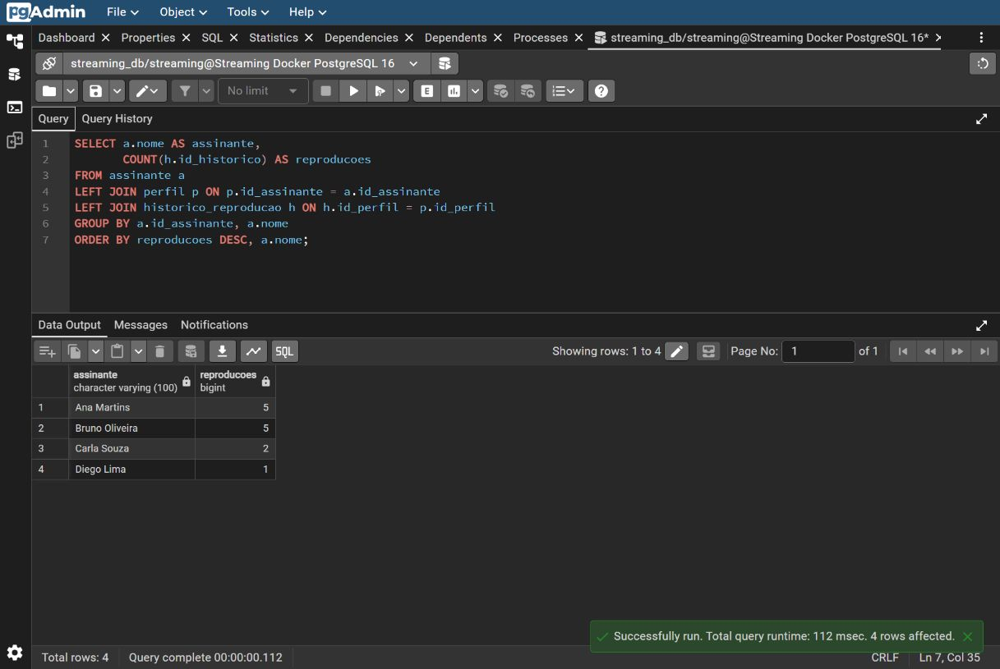

# Consultas da etapa 5

Três consultas com junções de três tabelas, compatíveis com `streaming_schema_v2.sql` e os dados de demonstração em `sql/02_dados.sql`.

## 1. Assinantes e perfis por plano

Mostra quantos assinantes e perfis existem em cada plano atual. Junta `assinante`, `plano` e `perfil`. `COUNT(DISTINCT a.id_assinante)` evita contar uma conta várias vezes quando ela possui vários perfis. `COUNT(p.id_perfil)` conta os perfis. Contas sem plano ficam no grupo Sem plano. A consulta considera todas as contas, inclusive inativas; não representa o plano vigente em datas passadas.

| Plano | Assinantes | Perfis |
| --- | --- | --- |
| Básico | 1 | 1 |
| Padrão | 1 | 2 |
| Premium | 1 | 2 |
| Sem plano | 1 | 1 |



## 2. Favoritos por assinante

Conta os favoritos salvos nos perfis de cada assinante. Junta `assinante`, `perfil` e `favorito`. O LEFT JOIN mantém quem não possui favoritos, mostrando zero. Se dois perfis da mesma conta salvarem a mesma mídia, são dois registros de favorito.

Resultado: Ana Martins — 5; Bruno Oliveira — 3; Carla Souza — 2; Diego Lima — 0.



## 3. Reproduções por assinante

Conta as sessões do histórico dos perfis de cada assinante, juntando `assinante`, `perfil` e `historico_reproducao`. Ordena do maior total para o menor. O LEFT JOIN mantém quem não possui reproduções, mostrando zero. Cada registro do histórico conta como uma sessão, incluindo sessões incompletas e repetidas; a consulta não conta títulos únicos nem minutos assistidos.

Resultado: Ana Martins — 5; Bruno Oliveira — 5; Carla Souza — 2; Diego Lima — 1.



## Execução

Com o ambiente Docker do projeto em execução, na raiz do repositório:

```bash
docker compose exec -T postgres psql -U streaming -d streaming_db -v ON_ERROR_STOP=1 -f /scripts/03_consultas.sql
```

O Compose já monta `sql/` em `/scripts`. Não é necessário recriar o volume ou recarregar os dados para executar as consultas. No pgAdmin, conecte ao banco `streaming_db`, abra o Query Tool e execute o arquivo. As três consultas são somente SELECT e podem ser executadas separadamente.

## Validação

As três consultas executaram com sucesso no PostgreSQL 16.15 do container local com a carga original do projeto. Cada uma retornou quatro linhas. As capturas são prints reais do pgAdmin, mostrando o SQL e o resultado da mesma consulta. A carga possui quatro assinantes, seis perfis, dez favoritos e treze sessões de reprodução.
